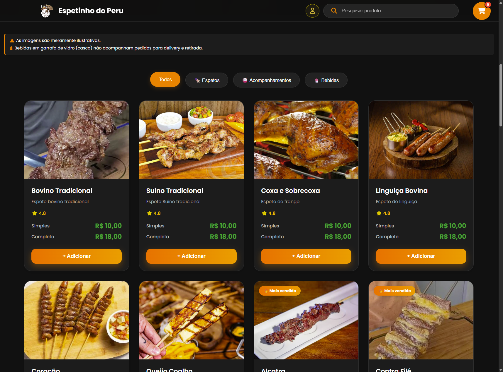
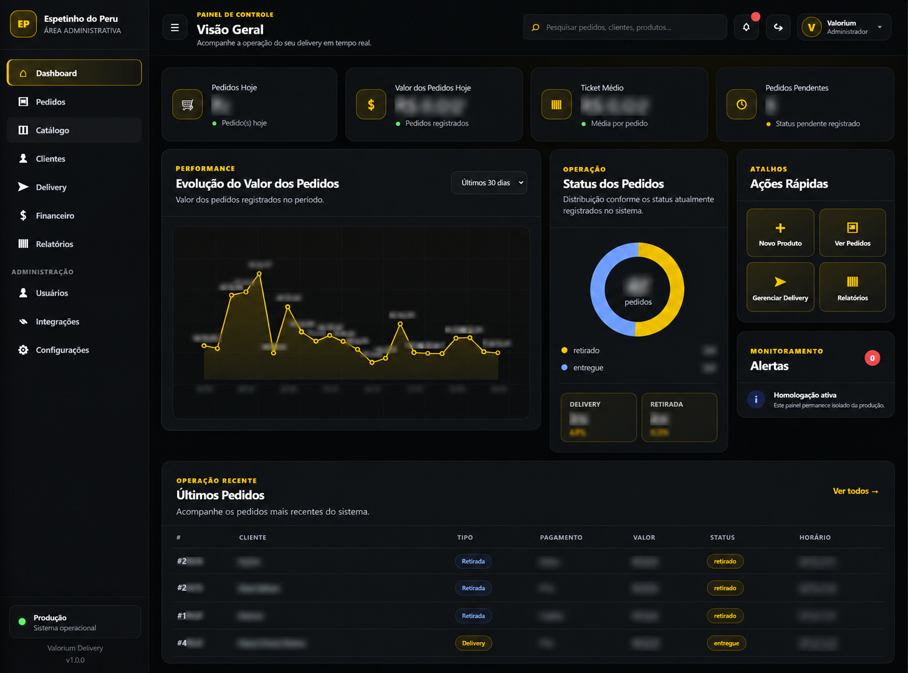
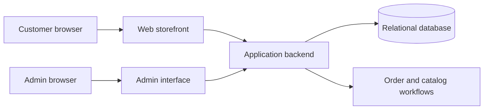

# Valorium Delivery

### Full Stack Web Application — Engineering Showcase

**PHP · JavaScript · HTML · CSS · SQL · Order Management**

A technical case study of a delivery storefront and administrative platform developed within the Valorium software ecosystem.

[Overview](#overview) · [Application preview](#application-preview) · [Architecture](#architecture) · [Engineering focus](#engineering-focus) · [Security](docs/security.md)

---

## Overview

Valorium Delivery is a web-based ordering and operations solution designed to connect a customer-facing product catalog with an administrative workflow for managing products, orders, and delivery operations. The showcased interface is configured for **Espetinho do Peru**, a business implementation of the platform.

This public repository is **documentation only**. It does not contain production source code, customer records, configuration secrets, or deployable software.

## Application preview

### Customer-facing storefront — real screenshot

*Actual interface screenshot illustrating product discovery, category navigation, item options and add-to-cart actions. Visible prices and products are illustrative of this captured environment, not claims about current availability.*

### Administrative dashboard — illustrative, privacy-safe preview

*Illustrative recreation based on the admin dashboard. It is **not** an exact redacted screenshot and must not be used as proof of specific live metrics or operational results. Names, transaction details and business figures are intentionally obscured.*

## Problem and approach

A delivery platform needs to make product selection intuitive for customers while giving operators visibility into orders, catalog management and business activity. The engineering challenge is to coordinate these separate experiences while keeping business logic, access controls and data integrity maintainable.

## Technology stack

| Layer | Technologies / concepts |
| --- | --- |
| Frontend | HTML, CSS, JavaScript |
| Backend | PHP |
| Data | SQL / relational data modeling |
| Product experience | Product cards, category navigation, cart interaction |
| Operations | Administrative dashboard, order and catalog workflows |
| Engineering | Integration boundaries, authorization, validation, maintainability |

## Architecture

*Conceptual diagram for portfolio communication; exact internal endpoints, database schema, hosting and security controls are not disclosed.*

Read more in [Architecture](docs/architecture.md) and [Order workflow](docs/order-workflow.md).

## Engineering focus

- Designing a responsive customer-facing catalog and a separate operational dashboard.
- Organizing frontend and backend responsibilities across business workflows.
- Modeling order lifecycle and product information without conflating user-facing and administrative actions.
- Considering authentication, role-based access, server-side validation and safe error handling.
- Maintaining clear boundaries between the commercial product and public technical documentation.

These are areas of engineering work and design; this document does not imply that every planned feature is fully released or independently verified.

## Implementation and evidence

The screenshots demonstrate visible user-interface elements. They do **not** independently establish payment processing, printer integration, order persistence, authorization correctness or production readiness. Functional claims should be expanded only after testing the corresponding private build.

See [Technical challenges](docs/technical-challenges.md) for verification ideas and design considerations.

## My role

**Guilherme Langkammer** — Founder & Software Developer, Valorium Sistemas. Project planning, web application development, UI implementation, integration design and troubleshooting.

## Contact

- [GitHub](https://github.com/Guilherme-Langkammer)
- [LinkedIn](https://www.linkedin.com/in/guilherme-de-paula-langkammer-1a64b0344/)
- Email: guilhermelangkammer008@gmail.com

## Notice

This repository is a portfolio case study. Valorium product code, deployment configuration, internal architecture, business data and client information remain private. No license to use proprietary software is granted.
