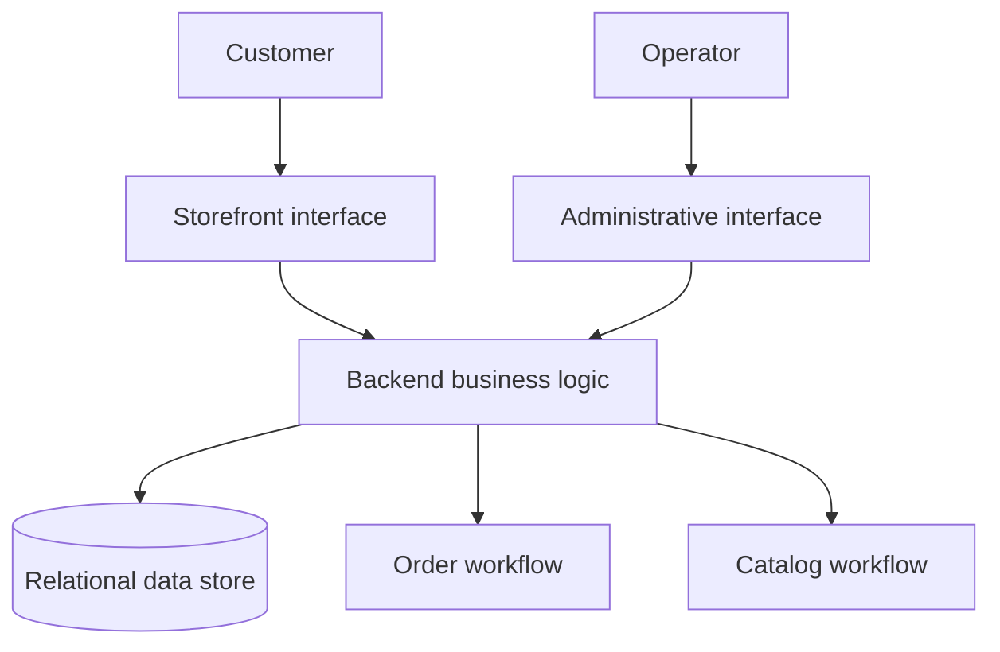

# Architecture — conceptual view

This document explains the public-facing responsibilities of the platform, not its production topology.

## Boundaries

- **Storefront:** customer product browsing and cart interaction.
- **Administrative interface:** catalog, order monitoring and operational views.
- **Backend:** validation, authorization and business rules (design responsibilities).
- **Data layer:** persistence and consistency of products and orders (conceptual).

Specific schemas, endpoints, hosting details, credentials and infrastructure identifiers are intentionally omitted. The diagram does not certify that all depicted responsibilities have passed end-to-end tests.
