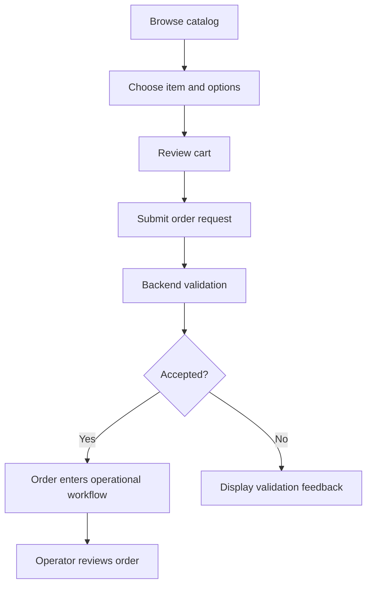

# Order workflow — conceptual

This is a **conceptual intended flow**, not evidence that every step has been implemented or tested in the current private deployment. Payment integrations, fulfillment automation and printing are not asserted as completed.
